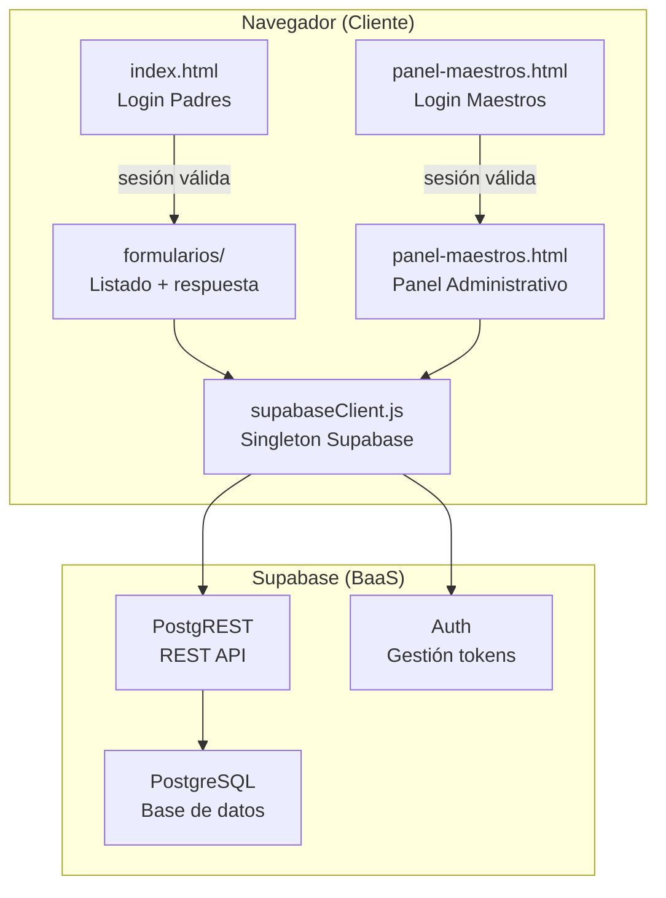
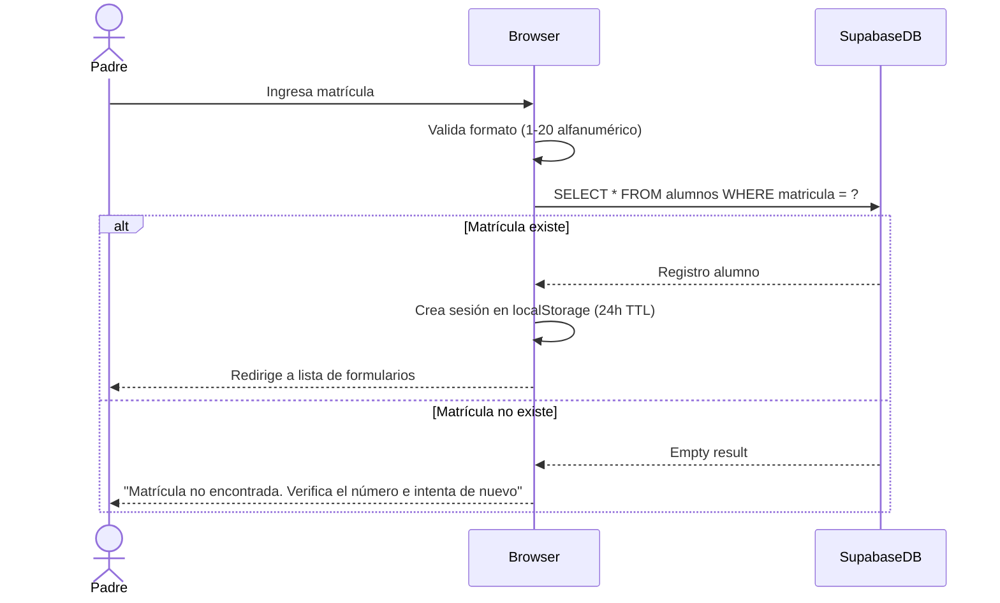
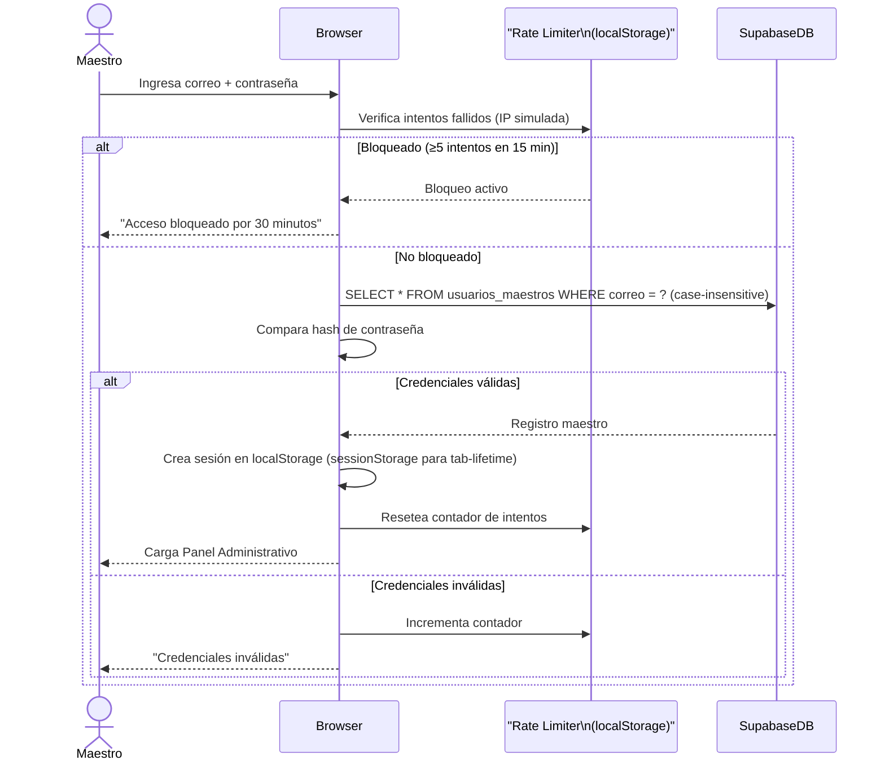

# Design Document

## Sistema de Autenticación por Roles, Formularios de Autorización y Panel de Control Docente

---

## Overview

El sistema es una aplicación web Multi-Page Application (MPA) construida con tecnologías estándar del navegador: HTML5, Tailwind CSS (CDN), JavaScript Vanilla y Supabase como backend-as-a-service. No existe paso de compilación ni bundler; cada página HTML es una unidad autónoma que carga scripts y estilos directamente desde el CDN de Tailwind y el CDN de Supabase.

El sistema atiende a dos tipos de usuarios con flujos completamente separados:

1. **Padres/Tutores** (`Usuario_Padre`) — acceden por matrícula del alumno, ven formularios activos y envían respuestas de autorización desde dispositivos móviles.
2. **Maestros/Dirección** (`Usuario_Maestro`) — acceden por correo y contraseña, gestionan eventos, visualizan métricas por grupo y exportan reportes.

Las sesiones de ambos roles se gestionan en `localStorage`. La comunicación con la base de datos pasa íntegramente por el cliente JavaScript de Supabase (PostgREST + Auth). No hay servidor intermedio propio.

### Alcance del sistema

- ~300 alumnos, uso no concurrente masivo esperado.
- Mobile-first: los padres usan principalmente smartphones.
- Sin instalación de apps nativas: la PWA-lite funciona desde el navegador.
- Sin dependencias de framework (React, Vue, etc.) ni build tools (Webpack, Vite).

---

## Architecture

### Diagrama de alto nivel



### Modelo de navegación (MPA)

```
/index.html                    → Login de padres / vista de formularios activos
/formularios/eventos.html      → Detalle de evento y formulario de respuesta
/formularios/vacunas.html      → Formulario específico de vacunas (reutiliza patrón)
/formularios/salidas.html      → Formulario de salidas escolares
/formularios/pases-salida.html → Formulario de pases de salida
/formularios/recoger-alumno.html → Formulario para autorizar recogida
/panel-maestros.html           → Login + Panel administrativo de maestros
```

Cada página HTML realiza al cargar (`DOMContentLoaded`) una verificación de sesión. Si no hay sesión válida redirige a la página de login correspondiente.

### Principios arquitectónicos

| Principio | Decisión |
|-----------|----------|
| Sin build | Tailwind vía CDN; Supabase JS vía CDN (`esm.sh` o CDN oficial) |
| Sin routing SPA | Cada vista es un archivo `.html`; la navegación es una redirección nativa |
| Separación de roles | Dos "zonas" HTML separadas: raíz (padres) y `panel-maestros.html` (maestros) |
| Seguridad en BD | Row Level Security (RLS) de Supabase como segunda línea de defensa |
| Estado mínimo en memoria | Solo sesión activa en `localStorage`; sin estado global complejo |

### Flujo de autenticación de padres



### Flujo de autenticación de maestros



---

## Components and Interfaces

### Módulos JavaScript compartidos

Todos los módulos se cargan como `<script type="module">` en cada HTML. No hay bundling.

#### `supabaseClient.js`

Singleton que exporta el cliente de Supabase inicializado.

```javascript
// Interfaz pública
export const supabase  // instancia de SupabaseClient
```

#### `auth.js` — Módulo de autenticación

```javascript
// Padres
export async function loginPadre(matricula)
  // → { ok: true, alumno: { matricula, nombre_completo, grupo } }
  // → { ok: false, error: 'formato' | 'no_encontrada' }

export function logoutPadre()
  // → void; limpia localStorage y redirige a index.html

export function getSesionPadre()
  // → { matricula, nombre_completo, grupo, expiresAt } | null

// Maestros
export async function loginMaestro(correo, password)
  // → { ok: true, maestro: { id, nombre, correo, rol, grupos } }
  // → { ok: false, error: 'credenciales' | 'bloqueado' | 'validacion' }

export function logoutMaestro()
  // → void; limpia localStorage/sessionStorage y redirige a panel-maestros.html

export function getSesionMaestro()
  // → { id, nombre, correo, rol, grupos, expiresAt } | null

// Guardias de ruta
export function requireSesionPadre()
  // → void; redirige a index.html si no hay sesión válida

export function requireSesionMaestro()
  // → void; redirige a panel-maestros.html#login si no hay sesión válida
```

#### `validation.js` — Módulo de validación

```javascript
export function validarMatricula(valor)
  // → { valid: boolean, error?: string }

export function validarCamposRespuesta(campos)
  // campos: { nombre_tutor, parentesco_tutor, autoriza, alergias, nota_adicional }
  // → { valid: boolean, errors: { [campo]: string } }

export function validarCamposEvento(campos)
  // campos: { titulo, descripcion, fecha_limite }
  // → { valid: boolean, errors: { [campo]: string } }

export function esCadenaNoVacia(valor)
  // → boolean  (excluye whitespace)

export function validarLongitud(valor, max)
  // → boolean
```

#### `eventos.js` — Módulo de gestión de eventos

```javascript
export async function obtenerEventosActivos(matricula)
  // → { data: Evento[], error? }
  // Incluye flag `respondido: boolean` consultando Tabla_Respuestas_Autorizaciones

export async function crearEvento(campos)
  // → { data: Evento, error? }

export async function actualizarEvento(id, campos)
  // → { data: Evento, error? }

export async function cambiarEstadoEvento(id, estado)
  // estado: 'activo' | 'inactivo'
  // → { data: Evento, error? }
```

#### `respuestas.js` — Módulo de respuestas de autorización

```javascript
export async function enviarRespuesta(campos)
  // campos: { evento_id, matricula_alumno, nombre_tutor, parentesco_tutor,
  //           autoriza, alergias, nota_adicional }
  // → { ok: true } | { ok: false, error: 'duplicado' | 'validacion' | 'red' }

export async function obtenerRespuestaExistente(evento_id, matricula_alumno)
  // → { data: Respuesta | null, error? }

export async function obtenerRespuestasEvento(evento_id)
  // → { data: Respuesta[], error? }
```

#### `metricas.js` — Módulo de métricas

```javascript
export async function calcularMetricasEvento(evento_id, grupos)
  // grupos: string[]  (grupos asignados al maestro)
  // → { data: MetricasEvento, error? }
  // MetricasEvento: { porGrupo: { [grupo]: { total, respondidos, faltantes, listaFaltantes } } }

export function suscribirActualizacionesMetricas(evento_id, callback)
  // Usa Supabase Realtime para detectar nuevas respuestas
  // → unsubscribeFn

export async function exportarRespuestasPDF(evento_id)
  // Usa jsPDF (CDN) para generar y descargar el PDF
  // → void
```

#### `rateLimiter.js` — Control de intentos de inicio de sesión

```javascript
export function registrarIntentoFallido(identificador)
  // → void

export function estaBloqueado(identificador)
  // → { bloqueado: boolean, tiempoRestante?: number }

export function resetearIntentos(identificador)
  // → void
```

#### `ui.js` — Utilidades de interfaz

```javascript
export function mostrarToast(mensaje, tipo)
  // tipo: 'exito' | 'error' | 'advertencia'
  // → void; muestra notificación no bloqueante

export function mostrarError(elementId, mensaje)
  // → void; muestra error inline en campo de formulario

export function limpiarErrores(formId)
  // → void

export function setBadgeEstado(elemento, estado)
  // estado: 'activo' | 'inactivo' | 'vencido' | 'enviado'
  // → void
```

### Estructura de páginas HTML

#### `index.html` — Dos vistas en una página

```
#vista-login    → visible si no hay sesión de padre
#vista-formularios → visible si hay sesión válida de padre
```

El JS al cargar verifica sesión y alterna visibilidad con `hidden` de Tailwind.

#### `panel-maestros.html` — Tres secciones

```
#seccion-login     → visible si no hay sesión de maestro
#seccion-panel     → visible si hay sesión válida (contiene tabs)
  #tab-eventos     → lista de eventos + crear/editar
  #tab-metricas    → selector de evento + métricas por grupo
  #tab-respuestas  → detalle de respuestas + exportar PDF
```

#### Páginas de formularios individuales (`formularios/*.html`)

Todas siguen el mismo patrón:
1. Verificar sesión de padre (`requireSesionPadre()`)
2. Leer `?evento_id=` de la URL
3. Verificar respuesta duplicada
4. Si existe: mostrar en modo solo lectura
5. Si no existe: mostrar formulario editable
6. Al enviar: llamar `enviarRespuesta()`, mostrar confirmación

---

## Data Models

### Tablas de Supabase (PostgreSQL)

#### `alumnos`

| Columna | Tipo | Restricciones |
|---------|------|---------------|
| `matricula` | `VARCHAR(20)` | PRIMARY KEY, NOT NULL |
| `nombre_completo` | `VARCHAR(200)` | NOT NULL |
| `grupo` | `VARCHAR(20)` | NOT NULL |
| `created_at` | `TIMESTAMPTZ` | DEFAULT now() |

#### `usuarios_maestros`

| Columna | Tipo | Restricciones |
|---------|------|---------------|
| `id` | `UUID` | PRIMARY KEY, DEFAULT gen_random_uuid() |
| `correo` | `VARCHAR(254)` | NOT NULL, UNIQUE, CITEXT o LOWER() |
| `password_hash` | `TEXT` | NOT NULL |
| `nombre` | `VARCHAR(200)` | NOT NULL |
| `rol` | `VARCHAR(50)` | NOT NULL, CHECK IN ('maestro', 'administrativo') |
| `grupos` | `TEXT[]` | NOT NULL, DEFAULT '{}' |
| `created_at` | `TIMESTAMPTZ` | DEFAULT now() |

> **Nota de diseño**: La contraseña se almacena como hash bcrypt. La comparación se realiza en el cliente con `bcrypt.js` (CDN). En una versión más robusta esto debería hacerse en una Edge Function de Supabase para mayor seguridad, pero dado que no se usa backend propio y el scope es escuela primaria ~300 alumnos, la comparación en cliente con Supabase RLS es aceptable.

#### `eventos_autorizaciones`

| Columna | Tipo | Restricciones |
|---------|------|---------------|
| `id` | `UUID` | PRIMARY KEY, DEFAULT gen_random_uuid() |
| `titulo` | `VARCHAR(200)` | NOT NULL |
| `descripcion` | `VARCHAR(1000)` | NOT NULL |
| `fecha_limite` | `DATE` | NOT NULL |
| `estado` | `VARCHAR(20)` | NOT NULL, CHECK IN ('activo', 'inactivo'), DEFAULT 'activo' |
| `creado_por` | `UUID` | FK → usuarios_maestros(id) |
| `created_at` | `TIMESTAMPTZ` | DEFAULT now() |

#### `respuestas_autorizaciones`

| Columna | Tipo | Restricciones |
|---------|------|---------------|
| `id` | `UUID` | PRIMARY KEY, DEFAULT gen_random_uuid() |
| `evento_id` | `UUID` | NOT NULL, FK → eventos_autorizaciones(id) ON DELETE CASCADE |
| `matricula_alumno` | `VARCHAR(20)` | NOT NULL, FK → alumnos(matricula) |
| `nombre_tutor` | `VARCHAR(100)` | NOT NULL |
| `parentesco_tutor` | `VARCHAR(50)` | NOT NULL |
| `autoriza` | `BOOLEAN` | NOT NULL |
| `alergias` | `VARCHAR(500)` | DEFAULT '' |
| `nota_adicional` | `VARCHAR(500)` | DEFAULT '' |
| `created_at` | `TIMESTAMPTZ` | DEFAULT now() |
| **UNIQUE** | | `(evento_id, matricula_alumno)` |

> La restricción UNIQUE a nivel de base de datos garantiza unicidad incluso ante condiciones de carrera entre dos envíos simultáneos. La validación en cliente (Req 11.1–11.3) es una primera línea de defensa, pero la BD es la fuente de verdad.

### Modelos JavaScript (estructuras en memoria)

```javascript
// Sesión de padre (localStorage key: 'sesion_padre')
{
  matricula: string,
  nombre_completo: string,
  grupo: string,
  expiresAt: number  // timestamp epoch ms
}

// Sesión de maestro (localStorage key: 'sesion_maestro')
{
  id: string,
  nombre: string,
  correo: string,
  rol: 'maestro' | 'administrativo',
  grupos: string[],
  expiresAt: number
}

// Registro de intentos fallidos (localStorage key: 'rate_limit_{correo}')
{
  intentos: number,
  primeraFallaEpoch: number,  // timestamp del primer intento en la ventana
  bloqueadoHasta?: number     // timestamp hasta el cual está bloqueado
}

// Objeto Evento (desde BD)
{
  id: string,
  titulo: string,
  descripcion: string,
  fecha_limite: string,  // 'YYYY-MM-DD'
  estado: 'activo' | 'inactivo',
  creado_por: string,
  created_at: string
}

// Objeto Respuesta (desde BD)
{
  id: string,
  evento_id: string,
  matricula_alumno: string,
  nombre_tutor: string,
  parentesco_tutor: string,
  autoriza: boolean,
  alergias: string,
  nota_adicional: string,
  created_at: string,
  // Join:
  alumno?: { nombre_completo: string, grupo: string }
}

// Métricas por evento
{
  evento_id: string,
  porGrupo: {
    [grupo: string]: {
      total: number,
      respondidos: number,
      faltantes: number,
      listaFaltantes: Array<{ matricula: string, nombre_completo: string }>
    }
  }
}
```

### Row Level Security (RLS) de Supabase

| Tabla | Lectura | Escritura |
|-------|---------|-----------|
| `alumnos` | Anónimo (SELECT por matrícula) | Solo admin BD |
| `usuarios_maestros` | Anónimo (SELECT por correo para login) | Solo admin BD |
| `eventos_autorizaciones` | Anónimo (SELECT estado=activo) | Anónimo con sesión maestro válida |
| `respuestas_autorizaciones` | Anónimo (SELECT por matricula_alumno) | Anónimo (INSERT único) |

> **Nota**: Dado que no se usa Supabase Auth (se simula la sesión en localStorage), todas las operaciones usan la `anon key`. Las políticas RLS limitan el daño potencial, pero la seguridad real depende de las restricciones de BD (UNIQUE, FK) y del control de acceso a la `service_role key` que nunca se expone en el cliente.

---

## Correctness Properties

*Una propiedad es una característica o comportamiento que debe mantenerse verdadero en todas las ejecuciones válidas de un sistema — esencialmente, una declaración formal sobre lo que el sistema debe hacer. Las propiedades sirven como puente entre las especificaciones legibles por humanos y las garantías de corrección verificables por máquinas.*

### Property 1: Validación de matrícula rechaza entradas inválidas

*Para cualquier* cadena que sea completamente vacía, compuesta solo de espacios en blanco, o que exceda 20 caracteres, la función `validarMatricula` SHALL retornar `{ valid: false }`.

**Validates: Requirements 1.1, 1.6**

### Property 2: Unicidad de respuesta por (evento, alumno)

*Para cualquier* combinación de `evento_id` y `matricula_alumno`, si ya existe una `Respuesta_Autorización` registrada con esa combinación, cualquier intento posterior de insertar otra respuesta con la misma combinación SHALL ser rechazado antes de escribir en la base de datos.

**Validates: Requirements 3.4, 11.1, 11.2, 11.3**

### Property 3: Validación de campos de respuesta rechaza entradas que superen longitudes máximas

*Para cualquier* conjunto de valores de campos de `Respuesta_Autorización`, si algún campo supera su longitud máxima permitida (`nombre_tutor` > 100, `parentesco_tutor` > 50, `alergias` > 500, `nota_adicional` > 500), la función `validarCamposRespuesta` SHALL retornar `{ valid: false }` con un mensaje identificando el campo problemático.

**Validates: Requirements 3.1, 3.8**

### Property 4: Campos obligatorios de respuesta rechazan cadenas solo-whitespace

*Para cualquier* valor de los campos obligatorios (`nombre_tutor`, `parentesco_tutor`, `autoriza`, `evento_id`, `matricula_alumno`), si el valor es una cadena compuesta únicamente de espacios en blanco, la validación SHALL rechazar el envío del formulario.

**Validates: Requirements 3.3**

### Property 5: Validación de campos de evento rechaza longitudes excesivas y fechas pasadas

*Para cualquier* conjunto de valores de campos de evento, si `titulo` excede 200 caracteres, `descripcion` excede 1000 caracteres, o `fecha_limite` es anterior a la fecha actual, la función `validarCamposEvento` SHALL retornar `{ valid: false }` con un mensaje específico por campo.

**Validates: Requirements 7.1, 7.7, 8.2**

### Property 6: La lista de eventos activos para padres excluye siempre eventos inactivos

*Para cualquier* estado de la base de datos, la función `obtenerEventosActivos` SHALL retornar únicamente eventos donde `estado = 'activo'`; ningún evento con `estado = 'inactivo'` SHALL aparecer en el resultado.

**Validates: Requirements 4.1, 12.2**

### Property 7: El rate limiter bloquea tras 5 intentos fallidos en 15 minutos

*Para cualquier* identificador de correo, si se registran 5 o más intentos fallidos dentro de una ventana de 15 minutos, la función `estaBloqueado` SHALL retornar `{ bloqueado: true }` para ese identificador durante 30 minutos desde el quinto intento.

**Validates: Requirements 5.7**

### Property 8: Expiración de sesión de padre a las 24 horas de inactividad

*Para cualquier* sesión de `Usuario_Padre` almacenada en `localStorage`, si el timestamp `expiresAt` es anterior al tiempo actual en el momento de invocar `getSesionPadre`, la función SHALL retornar `null` y eliminar la sesión del almacenamiento.

**Validates: Requirements 1.7, 13.3**

### Property 9: Expiración de sesión de maestro a las 8 horas

*Para cualquier* sesión de `Usuario_Maestro` almacenada, si el timestamp `expiresAt` es anterior al tiempo actual en el momento de invocar `getSesionMaestro`, la función SHALL retornar `null` y eliminar la sesión del almacenamiento.

**Validates: Requirements 5.8, 6.7, 13.3**

### Property 10: Ordenación de eventos por fecha límite ascendente

*Para cualquier* lista de eventos activos retornada por `obtenerEventosActivos`, los eventos SHALL estar ordenados de manera que para todo par de eventos consecutivos `(a, b)`, se cumpla que `a.fecha_limite ≤ b.fecha_limite`.

**Validates: Requirements 4.4**

### Property 11: Los campos opcionales de respuesta se almacenan como cadena vacía si no se proporcionan

*Para cualquier* `Respuesta_Autorización` insertada exitosamente donde `alergias` o `nota_adicional` no fueron proporcionados por el usuario, los campos correspondientes en `Tabla_Respuestas_Autorizaciones` SHALL contener una cadena vacía (`''`) y no `NULL`.

**Validates: Requirements 3.2**

---

## Error Handling

### Estrategia general

Todos los errores siguen un modelo de dos niveles:

1. **Nivel de usuario**: Mensaje en lenguaje natural, sin términos técnicos, visible en la UI.
2. **Nivel de diagnóstico**: Información técnica (timestamp, tabla, código HTTP, operación) registrada en `console.error()` únicamente, nunca expuesta al usuario.

```javascript
// Patrón estándar de manejo de errores en módulos
async function operacionConBD() {
  try {
    const { data, error } = await supabase.from('tabla').select()
    if (error) {
      console.error('[BD Error]', { timestamp: Date.now(), tabla: 'tabla', error })
      return { ok: false, mensajeUsuario: 'No se pudo conectar...' }
    }
    return { ok: true, data }
  } catch (err) {
    console.error('[Red Error]', { timestamp: Date.now(), err })
    return { ok: false, mensajeUsuario: 'Verifica tu conexión a internet' }
  }
}
```

### Catálogo de mensajes de error por escenario

| Escenario | Mensaje visible al usuario | Req |
|-----------|---------------------------|-----|
| Matrícula formato inválido | "Formato de matrícula inválido" | 1.6 |
| Matrícula no encontrada | "Matrícula no encontrada. Verifica el número e intenta de nuevo" | 1.3 |
| Credenciales de maestro incorrectas | "Credenciales inválidas. Verifica tu correo y contraseña" | 5.6 |
| Maestro bloqueado por intentos | "Acceso bloqueado por 30 minutos por múltiples intentos fallidos" | 5.7 |
| Respuesta duplicada | "Ya existe una respuesta registrada para este evento. Puedes verla en tu lista de formularios enviados" | 3.4, 11.3 |
| Campo obligatorio vacío | "El campo [nombre] es obligatorio" | 3.3, 7.3 |
| Campo excede longitud máxima | "El campo [nombre] no puede exceder [N] caracteres" | 3.1, 3.8 |
| Error de red en lectura | "No se pudo conectar a la base de datos. Verifica tu conexión a internet" | 15.1 |
| Error de red en escritura | "No se pudo guardar la información. Verifica tu conexión a internet e intenta nuevamente" | 15.2 |
| Error de red al cerrar sesión | "La sesión se cerró localmente" (y redirige) | 2.4, 6.5 |
| Fallo de evento (3 intentos) | "Hemos detectado problemas de conexión. Verifica tu internet o intenta más tarde. Si el problema persiste, contacta soporte técnico" | 15.5 |
| localStorage no disponible | "El almacenamiento local no está disponible. Por favor habilita las cookies y el almacenamiento local en tu navegador para usar esta aplicación" | 13.6 |
| Sesión expirada | "Tu sesión ha expirado. Por favor inicia sesión nuevamente" | 6.7, 13.3 |
| Sin conexión (modo offline) | Indicador "Modo sin conexión" persistente en la barra superior | 13.7 |
| Tamaño de pantalla no optimizado | "El tamaño de pantalla no está optimizado. Ajusta el tamaño de la ventana" | 10.9 |

### Manejo del contador de reintentos (Req 15.5)

```javascript
// En cada módulo que realiza operaciones críticas (enviarRespuesta, crearEvento)
const REINTENTOS_MAX = 3
const VENTANA_REINTENTOS_MS = 2 * 60 * 1000  // 2 minutos

let contadorReintentos = 0
let primeraFallaTs = null

function manejarErrorCritico() {
  const ahora = Date.now()
  if (!primeraFallaTs || ahora - primeraFallaTs > VENTANA_REINTENTOS_MS) {
    primeraFallaTs = ahora
    contadorReintentos = 1
  } else {
    contadorReintentos++
  }
  if (contadorReintentos >= REINTENTOS_MAX) {
    mostrarToast(MENSAJES.FALLO_CRITICO, 'error')
  }
}
```

### Preservación de datos de formulario ante errores

Cuando un envío falla por error de red, los valores de los campos se preservan en el DOM (no se limpian). Adicionalmente se guarda un borrador en `sessionStorage` para sobrevivir recargas involuntarias:

```javascript
// Guardar borrador
sessionStorage.setItem('borrador_respuesta', JSON.stringify(campos))

// Restaurar borrador al cargar la página
const borrador = sessionStorage.getItem('borrador_respuesta')
if (borrador) rellenarFormulario(JSON.parse(borrador))
```

---

## Testing Strategy

### Enfoque general

El proyecto usa testing de dos tipos complementarios:

1. **Tests unitarios** para lógica pura (validación, formateo de fechas, rate limiter, ordenación).
2. **Tests de propiedad** para verificar invariantes universales con inputs generados.

Dado que el proyecto no usa build tools, los tests se ejecutan con [Vitest](https://vitest.dev/) configurado para entorno `jsdom`, que puede correr sin bundler en modo CLI. Los módulos a testear (`validation.js`, `auth.js`, `rateLimiter.js`, `respuestas.js`, `metricas.js`) no tienen dependencias del DOM, lo que facilita el testing en aislamiento.

Para las interacciones con Supabase, se utilizan mocks del cliente Supabase.

### Tests unitarios (basados en ejemplos)

| Módulo | Caso de prueba |
|--------|---------------|
| `validation.js` | Matrícula vacía → inválida |
| `validation.js` | Matrícula de 21 caracteres → inválida |
| `validation.js` | Matrícula `"ABC123"` → válida |
| `validation.js` | `nombre_tutor` de 101 chars → inválido |
| `validation.js` | Todos los campos válidos → objeto de validación sin errores |
| `validation.js` | `fecha_limite` de ayer → inválida |
| `auth.js` | `getSesionPadre()` con `expiresAt` en el pasado → null |
| `auth.js` | `getSesionMaestro()` con sesión vigente → objeto sesión |
| `rateLimiter.js` | 4 intentos en 15 min → no bloqueado |
| `rateLimiter.js` | 5 intentos en 15 min → bloqueado |
| `rateLimiter.js` | 5 intentos, luego 30 min pasan → desbloqueado |
| `rateLimiter.js` | Resetear tras login exitoso → contador a 0 |
| `metricas.js` | Grupo con 5 alumnos, 3 respuestas → `{ total: 5, respondidos: 3, faltantes: 2 }` |
| `respuestas.js` | Respuesta duplicada → `{ ok: false, error: 'duplicado' }` |

### Tests de propiedad (Property-Based Testing)

Se usa **[fast-check](https://fast-check.dev/)** como librería de PBT para JavaScript. Cada test se configura con mínimo 100 iteraciones.

#### Implementación de propiedades del diseño

**Property 1 — Validación de matrícula rechaza entradas inválidas**
```
Feature: sistema-autenticacion-formularios-escolares, Property 1:
validarMatricula rechaza entradas vacías, whitespace-only o >20 caracteres
```
Generadores: cadenas vacías, cadenas de solo espacios/tabs, cadenas de longitud 21-100.

**Property 2 — Unicidad de respuesta por (evento, alumno)**
```
Feature: sistema-autenticacion-formularios-escolares, Property 2:
verificarDuplicado retorna true para cualquier combinación (evento_id, matricula) ya registrada
```
Generadores: UUIDs arbitrarios para `evento_id`, strings alfanuméricos para `matricula_alumno`.

**Property 3 — Validación de longitudes máximas en respuestas**
```
Feature: sistema-autenticacion-formularios-escolares, Property 3:
validarCamposRespuesta retorna error para cualquier campo que supere su límite
```
Generadores: strings de longitud `limit + 1` a `limit + 200` para cada campo.

**Property 4 — Campos obligatorios rechazan solo-whitespace**
```
Feature: sistema-autenticacion-formularios-escolares, Property 4:
validarCamposRespuesta retorna error para cualquier cadena de solo whitespace en campos obligatorios
```
Generadores: strings de ` `, `\t`, `\n` y combinaciones de estos.

**Property 5 — Validación de eventos rechaza fechas pasadas y longitudes excesivas**
```
Feature: sistema-autenticacion-formularios-escolares, Property 5:
validarCamposEvento retorna error para cualquier fecha anterior a hoy o campo que exceda su límite
```
Generadores: fechas aleatorias anteriores a `Date.now()`, strings de longitud > límite.

**Property 6 — Lista de eventos activos excluye inactivos**
```
Feature: sistema-autenticacion-formularios-escolares, Property 6:
obtenerEventosActivos retorna únicamente eventos con estado='activo' para cualquier estado de BD
```
Generadores: arrays arbitrarios de eventos con estado aleatorio (`activo` / `inactivo`), mock de Supabase que devuelve ese array; verificar que cada elemento del resultado tiene `estado = 'activo'`.

**Property 7 — Rate limiter bloquea tras 5 intentos en ventana de 15 min**
```
Feature: sistema-autenticacion-formularios-escolares, Property 7:
estaBloqueado retorna true para cualquier correo con ≥5 intentos en ventana de 15 min
```
Generadores: emails arbitrarios, contadores de intentos entre 5 y 20, timestamps dentro de la ventana de 15 min.

**Property 8 — Sesión de padre expirada retorna null**
```
Feature: sistema-autenticacion-formularios-escolares, Property 8:
getSesionPadre retorna null para cualquier sesión cuyo expiresAt sea anterior al momento actual
```
Generadores: sesiones arbitrarias con `expiresAt` en el rango `[0, Date.now() - 1]`.

**Property 9 — Sesión de maestro expirada retorna null**
```
Feature: sistema-autenticacion-formularios-escolares, Property 9:
getSesionMaestro retorna null para cualquier sesión cuyo expiresAt sea anterior al momento actual
```
Generadores: sesiones arbitrarias con `expiresAt` en el rango `[0, Date.now() - 1]`.

**Property 10 — Eventos ordenados por fecha_limite ascendente**
```
Feature: sistema-autenticacion-formularios-escolares, Property 10:
obtenerEventosActivos retorna lista donde para todo par consecutivo a,b se cumple a.fecha_limite ≤ b.fecha_limite
```
Generadores: arrays de eventos con fechas aleatorias mezcladas.

**Property 11 — Campos opcionales almacenados como cadena vacía**
```
Feature: sistema-autenticacion-formularios-escolares, Property 11:
enviarRespuesta almacena '' en alergias y nota_adicional cuando no se proporcionan valores
```
Generadores: objetos de respuesta válidos donde `alergias` y `nota_adicional` son `undefined`, `null` o no están presentes.

### Tests de integración (ejemplos concretos contra Supabase)

Los tests de integración se ejecutan contra un proyecto Supabase de staging separado y validan que las configuraciones de RLS y las restricciones de BD funcionan como se espera:

| Escenario | Verificación |
|-----------|-------------|
| INSERT duplicado en `respuestas_autorizaciones` | Supabase retorna error de unique constraint |
| SELECT de eventos inactivos desde anon key | Retorna array vacío si RLS está bien configurado |
| INSERT de evento sin token de maestro | RLS rechaza la operación |
| Expiración de sesión (simulada manipulando `expiresAt`) | El guard redirige a login |

### Cobertura objetivo

- **Módulos de validación**: 100% de ramas (cada condición de validación cubierta)
- **Módulo de rate limiter**: 100% de ramas
- **Módulos de autenticación**: 80%+ (excluyendo flujos de error de red poco reproducibles)
- **Tests de propiedad**: mínimo 100 iteraciones por propiedad (configurado en fast-check)
- **Tests de integración**: 1 test por escenario crítico de BD

### Configuración de Vitest

```javascript
// vitest.config.js
import { defineConfig } from 'vitest/config'

export default defineConfig({
  test: {
    environment: 'jsdom',
    globals: true,
    setupFiles: ['./test/setup.js']
  }
})
```

```javascript
// test/setup.js
// Mock de localStorage para todos los tests
import { vi } from 'vitest'

const localStorageMock = (() => {
  let store = {}
  return {
    getItem: (key) => store[key] ?? null,
    setItem: (key, val) => { store[key] = String(val) },
    removeItem: (key) => { delete store[key] },
    clear: () => { store = {} }
  }
})()
Object.defineProperty(global, 'localStorage', { value: localStorageMock })

// Mock del cliente Supabase
vi.mock('../supabaseClient.js', () => ({
  supabase: {
    from: vi.fn(() => ({
      select: vi.fn(),
      insert: vi.fn(),
      update: vi.fn(),
      eq: vi.fn(),
      single: vi.fn()
    }))
  }
}))
```
